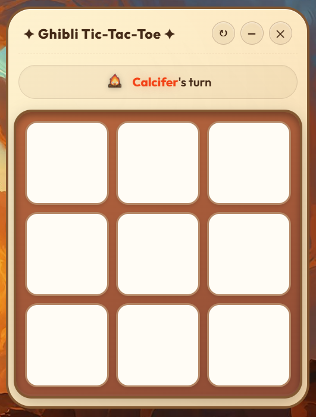
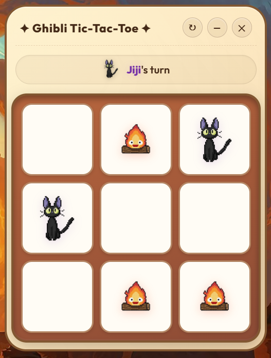
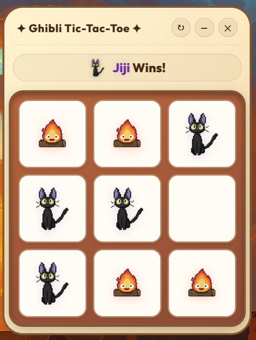

<div align="center">

# ✦ Ghibli Tic-Tac-Toe ✦

A cute, lightweight desktop Tic-Tac-Toe game styled with warm, cozy Ghibli vibes. 

<p align="center">
  
  
  
  
  
</p>

<p align="center">
  Play as <strong>Calcifer</strong> (<em>Howl's Moving Castle</em>) or <strong>Jiji</strong> (<em>Kiki's Delivery Service</em>) in a warm, cozy desktop experience powered by modern systems architecture.
</p>

</div>

---

## 📸 In-Game Preview

<div align="center">
  <table>
    <tr>
      <td align="center">
        
        <br />
        <sub><b>Main Board & Frameless UI</b></sub>
      </td>
      <td align="center">
        
        <br />
        <sub><b>Dynamic Turn & Character Sprites</b></sub>
      </td>
      <td align="center">
        
        <br />
        <sub><b>Win Detection & Custom Dialogues</b></sub>
      </td>
    </tr>
  </table>
</div>

---
## Features:
- 🦀 **Tauri v2 + Rust Architecture**: Built with a lightweight Rust desktop shell rather than memory-heavy Electron wrappers, yielding instant startup and near-zero idle memory consumption.
- 🪟 **Custom Frameless Window Engineering**: Custom non-decorated, semi-transparent window architecture with custom OS window management (native window dragging via `startDragging`, minimization, and closing controls integrated directly into the web canvas).
- 🔄 **Universal Runtime Fallback**: Programmed with runtime environment detection (`isTauri()`), allowing the entire application to seamlessly run both as a **standalone desktop executable** and inside any **standard web browser** without breaking native API calls.
- 🎨 **Tailored Ghibli UI/UX**: Custom CSS design system using warm HSL palettes, glow filters, responsive sprite animations, and custom typography (`Outfit`).
- 💬 **Dynamic Character Narrative System**: State-aware character quote engine that reacts dynamically across game phases (*early, mid, late, won, lost, draw*).

---

## 🚀 Getting Started

### Prerequisites

- **Node.js** (v18 or newer)
- **[Rust & Cargo](https://rustup.rs/)** + Visual Studio C++ Build Tools

### 1. Clone & Install Dependencies

```bash
git clone https://github.com/your-username/Ghibli-Tic-Tac-Toe.git
cd Ghibli-Tic-Tac-Toe
npm install
```

### 2. Run in Development Mode

**Web Browser Mode (Instant, no Rust required):**
```bash
npm run dev
```

**Native Desktop Mode (Powered by Tauri & Rust):**
```bash
npm run tauri dev
```

### 3. Production Build

To compile a native, optimized desktop executable (`.exe` / `.msi`):
```bash
npm run tauri build
```

---

## 🎨 Credits & Acknowledgments

- Characters **Calcifer** & **Jiji** inspired by the timeless works of **Studio Ghibli** (*Howl's Moving Castle* & *Kiki's Delivery Service*).
- Built with ❤️ using modern web & desktop technologies.
